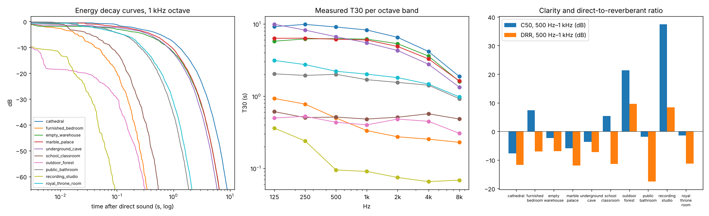

# Environment comparison

Source: `voice_dry.wav` (8.3 s, 48000 Hz). Seed 0. Regenerate with `python demo/run_comparison.py`.

C50/DRR are 500 Hz–1 kHz means (ISO 3382 mid convention). *Predicted* = statistical model (Eyring / Sabine) from the room description. *Measured* = ISO 3382-style analysis of the simulated impulse response (omni channel).

| Environment | V (m³) | r (m) | Predicted T60 Eyring 500/1k (s) | Sabine 1k | Measured T30 125 / 1k / 4k (s) | EDT 1k | C50 mid (dB) | DRR mid (dB) | r_crit 1k (m) | Centroid (Hz) |
|---|---|---|---|---|---|---|---|---|---|---|
| Cathedral | 39000 | 18.0 | 9.20 / 8.38 | 8.52 | 9.22 / 8.27 / 4.16 | 8.31 | -7.7 | -11.7 | 5.28 | 595 |
| Furnished bedroom | 38 | 2.1 | 0.38 / 0.30 | 0.34 | 0.93 / 0.33 / 0.25 | 0.26 | 7.4 | -7.1 | 0.86 | 501 |
| Empty warehouse | 15000 | 7.2 | 6.35 / 6.25 | 6.44 | 5.79 / 6.18 / 3.60 | 5.86 | -2.3 | -6.9 | 3.79 | 710 |
| Marble palace hall | 5280 | 8.1 | 6.25 / 6.21 | 6.31 | 6.35 / 6.01 / 3.29 | 6.07 | -5.9 | -11.9 | 2.26 | 621 |
| Underground cave | 8640 | 6.3 | 6.60 / 5.44 | 5.62 | 9.93 / 5.50 / 2.77 | 5.50 | -3.7 | -7.3 | 3.08 | 600 |
| School classroom | 189 | 5.0 | 0.58 / 0.50 | 0.56 | 0.61 / 0.48 / 0.57 | 0.49 | 5.4 | -11.4 | 1.51 | 736 |
| Outdoor forest | 24000 | 4.2 | 0.42 / 0.38 | 0.81 | 0.50 / 0.40 / 0.45 | 0.02 | 21.3 | 9.6 | 19.45 | 870 |
| Public bathroom | 78 | 3.4 | 2.09 / 1.67 | 1.72 | 2.04 / 1.70 / 1.42 | 1.65 | -1.9 | -17.6 | 0.53 | 610 |
| Recording studio | 90 | 0.8 | 0.12 / 0.10 | 0.16 | 0.36 / 0.09 / 0.07 | 0.02 | 37.4 | 8.4 | 2.36 | 851 |
| Royal throne room | 4200 | 12.0 | 2.13 / 2.01 | 2.15 | 3.13 / 2.02 / 1.47 | 1.91 | -1.5 | -11.3 | 3.54 | 605 |

## Positioning variants (Royal throne room)

| Variant | r (m) | DRR mid (dB) | C50 mid (dB) | Centroid (Hz) |
|---|---|---|---|---|
| facing_away | 12.0 | -15.5 | -3.3 | 558 |
| obstructed | 12.0 | -21.7 | -4.1 | 547 |
| close_2m | 2.0 | 3.1 | 6.6 | 800 |
| far_16m | 16.0 | -13.2 | -2.1 | 587 |

